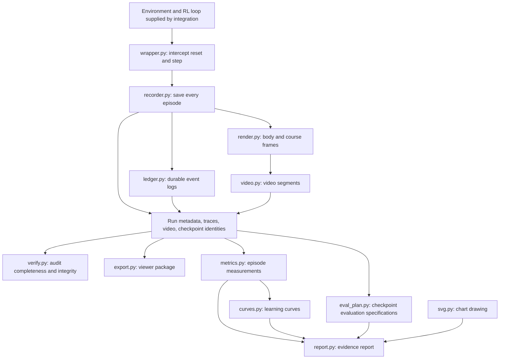

# What each file in src/ does

This guide covers **`src/ariel/analysis/` and `src/ariel/recording/`**.
The pulled repository now also contains simulator/training code under
`src/ariel/mocap/` and other modules. See [ACTIVE-FILES.md](ACTIVE-FILES.md)
for every current file and [PULL-REVIEW.md](PULL-REVIEW.md) for integration gaps.

The modules described here support RL training and explain results; they do
not implement the simulator or train the policy themselves. Their earlier 2D
point format does not directly read the new trainer's 3D joint-state recordings
from `src/ariel/record/`. These two recording implementations are distinct.

The package is located at `src/ariel/`. Links below follow the current files.
This guide describes code responsibilities, not evidence that real training
or simulator integration has passed validation.

## Recording: capture and preserve every attempt

Files under `src/ariel/recording/` provide the recording infrastructure for A3.
The training environment supplies physical state, actions, rewards, and policy
identity; these modules save and package that information.

| File | Plain-language purpose | Main responsibilities |
|---|---|---|
| [recorder.py](../src/ariel/recording/recorder.py) | The main recording system. | `RunRecorder` manages run/worker identity and checkpoint registration. `EpisodeRecorder` saves physical traces, actions, rewards, video, and policy lineage. Interrupted episodes retain recoverable output and disclose missing data. |
| [wrapper.py](../src/ariel/recording/wrapper.py) | Attach recording to an environment automatically. | `RecordingEnv` intercepts `reset()` and `step()`, captures initial state and transitions, tracks policy versions, and ends recordings when attempts finish. Supports older and newer Gym-style return formats without importing Gym. |
| [ledger.py](../src/ariel/recording/ledger.py) | Keep a durable event log. | Appends hash-linked JSON records, flushes writes, checks log integrity, and provides atomic file-writing helpers. `RecordingError` signals persistence failure so training can stop. |
| [render.py](../src/ariel/recording/render.py) | Turn body/world states into pictures. | `render_frame` draws body points and rectangular obstacles using a lunar palette. `View` defines the camera. Rendering does not simulate physics or choose actions. |
| [video.py](../src/ariel/recording/video.py) | Turn frames into video segments. | `SegmentedVideoWriter` uses fragmented H.264 MP4 segments to preserve usable footage after interruption and bound the amount potentially lost. |
| [verify.py](../src/ariel/recording/verify.py) | Audit whether recordings are complete and intact. | Checks event-log chains, episode numbering, starts/finishes, summaries, trace coverage, file hashes, and checkpoint files. Optional video decoding checks recorded frame counts. |
| [export.py](../src/ariel/recording/export.py) | Prepare recorded runs for the web viewer. | Writes an index, downsampled JSON traces, and video files with runtime/checkpoint metadata. Discloses missing or corrupt data and applies held-out reporting guards. |
| [fixture.py](../src/ariel/recording/fixture.py) | Make synthetic examples for interface development. | Scripts a deforming body's movement, episode outcomes, and placeholder checkpoint identities. Explicitly labels them as fixtures. Apparent improvement is scripted, not learned. |
| [costs.py](../src/ariel/recording/costs.py) | Measure recording overhead. | Benchmarks synthetic motion with traces alone versus rendering/video encoding, reporting time and storage use. This measures recording overhead, not simulator speed or RL performance. |
| [__init__.py](../src/ariel/recording/__init__.py) | Provide convenient imports. | Exposes the recorder classes, recording error, ledger reader, renderer, view settings, shape descriptors, and termination handler. |

### What the recorder saves

The recorder organizes output by run, worker, and episode:

```text
<run>/
  run.json                       run identity and metadata
  workers/<worker>/
    worker.json                  worker identity and recording settings
    episodes.jsonl               episode and worker-session event log
    checkpoints.jsonl            saved-model identities and training progress
    episodes/<episode>/
      trace-meta.npz             initial body state and recorded point indices
      trace-NNNN.npz             incremental numerical trace chunks
      video.segNNN.mp4           recorded video segments
      episode.json               final summary, file identities, and status
```

Checkpoint registration records an existing model file's identity and training
progress. It does not train the model or create its weights. Numerical traces
and video serve different purposes: traces support inspection and analysis;
video makes behavior easy to watch without rerunning physics.

The recorder is designed to retain completed chunks after interruption. A crash
can still lose recent buffered data or the end of a video segment. Recovery
must disclose those gaps rather than invent a complete outcome. Each worker
uses its own writer/log; the training integration must record every worker.

## Analysis: interpret the recorded evidence

Files under `src/ariel/analysis/` support A6. They consume recorder outputs;
they do not run the physics or make the policy learn.

| File | Plain-language purpose | Main responsibilities |
|---|---|---|
| [metrics.py](../src/ariel/analysis/metrics.py) | Turn recorded episodes into measurements. | Loads episodes across workers, checks supported schemas and trace integrity, identifies course configurations, and computes progress, reward, completion, body-shape statistics, exploration, and failure information. Unsupported or unverifiable values remain missing. |
| [curves.py](../src/ariel/analysis/curves.py) | Show how behavior changes through training. | Orders episodes by training progress and calculates rolling means/medians for reward, progress, completion, and exploration share. Keeps episode kinds separate so fixtures and evaluations do not enter the default training curve. |
| [eval_plan.py](../src/ariel/analysis/eval_plan.py) | Prepare fair checkpoint comparisons. | Selects saved checkpoints and creates checkpoint/course/seed evaluation specifications for Guhan to execute. Tracks first viewing of held-out results and guards against using those results to select later checkpoints. |
| [report.py](../src/ariel/analysis/report.py) | Assemble a readable evidence report. | Produces Markdown, CSV, JSON, and SVG outputs covering learning curves, checkpoint comparisons, shape usage, failures, uncertainty intervals, runtime identity, and evidence gaps. Excludes fixtures from learning comparisons and withholds guarded results. |
| [svg.py](../src/ariel/analysis/svg.py) | Draw charts for the reports. | Builds SVG line and bar charts, including uncertainty bars, labels, light/dark colors, and tooltips, without a plotting-library dependency. |
| [__init__.py](../src/ariel/analysis/__init__.py) | Provide convenient analysis imports. | Exposes metric and curve helpers and lazily loads evaluation/report functions so their command-line modules load cleanly. |

An evaluation plan specifies work; it does not execute that work. A learning
curve describes recorded behavior; an upward curve alone does not establish
that reshaping caused improvement. That needs an appropriate comparison, such
as the selected restricted-control baseline described in
[evaluation-plan.md](evaluation-plan.md).

Missing information stays missing. For example, a recovered trace can establish
some surviving steps without proving the complete episode return. Reports
retain incomplete attempts and failures rather than showing only successes.

## The top-level package file

[src/ariel/__init__.py](../src/ariel/__init__.py) marks the main Python package
and describes the project. It does not contain simulator or training logic.

## How the files connect



`fixture.py` exercises the same recording/export interfaces using artificial
data. `costs.py` exercises recording to measure overhead. Neither is evidence
of learned movement or real obstacle-course success.

For integration details, read [recording-contract.md](recording-contract.md).
For evaluation methodology, read [evaluation-plan.md](evaluation-plan.md).
The active ownership and task index remain [TASKS.md](TASKS.md). Compute jobs,
including analysis and bulk encoding, are handed to Guhan for Modal execution.
